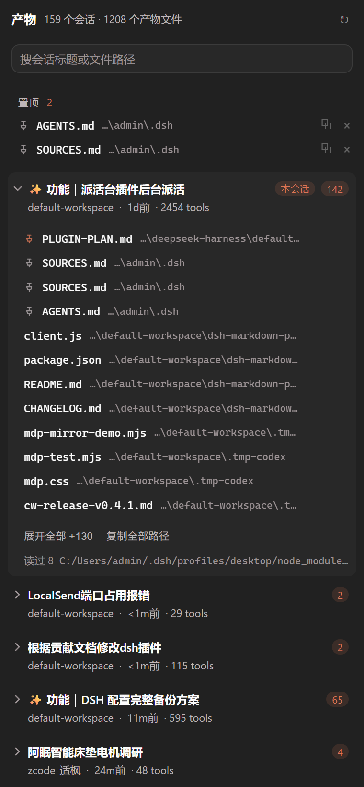

[简体中文](README.md) · **English**

# Session artifacts · dsh-session-artifacts

A right-sidebar tab for the DeepSeek Harness (DSH) Web UI: **one list of every file every Session produced**, with the Session you are in pinned on top, the file name and its parent directory on separate lines, and one-click path copy.

It writes nothing and changes nothing on disk. It only turns the record that already sits in the session logs — which Session wrote which path — back into a column you can read, so the next Session can pick up the last one's work instead of re-scanning the tree.



## Why it exists

Which files a Session created or edited is invisible afterwards. The session log has that record, but a log is a stream for reading, not an inventory. So the next Session has two options: re-scan the tree (slow, and never complete) or ask the human to point at things from memory (slower, and lossy).

This turns that stream into an inventory. It does not "tidy" anything — every file stays exactly where it is; it only makes "what did the last run touch" a list you can read at a glance and copy from in one click.

## Interaction

| Action | Result |
| --- | --- |
| Click a file row | Copies the file's full path |
| Double-click a file row | Opens a preview in the right sidebar; a second docked pane when the column can split |
| Enter on a focused row | Same as double-click |
| ⧉ | Copies only, without the row's own action |
| 📌 (on hover) | Opens both pin scopes: this Session / every Session |
| × in the pinned section | Unpins the global pin outright |

- **Two pin scopes**: a global pin sits in its own section above every Session; a Session pin only moves that file to the front of its Session's list. Pins live on the host (`~/.dsh/session-artifacts-pins.json`), so they survive reloads and Session switches.
- **The current Session** always leads the list, expanded, with a small "this one" marker — the pane is per Session, and the one you are in is usually the one you are looking for.
- The search box matches Session title, working directory and produced paths.
- Colours and motion follow the active skin (on this machine `dsh-claude-style`): colour only through host tokens, 0.5px separators, radii from the 4/8/16 ladder, motion only through the skin's duration and easing tokens — **every token carries a fallback**, so the tab still renders when the skin is switched off.

## Install

This is a DSH bundle: `package.json` declares `dsh.bundle.patch` pointing at `cordis.patch.yml`, so a plugin manager can install it as one profile patch layer.

**From GitHub.** Install it from the sidebar's Plugins page with the source:

```
github:accoutmissing/dsh-session-artifacts
```

or from your own profile on the command line (the `desktop` profile is managed by the Desktop app and the CLI refuses `--profile desktop`, so use the page above there):

```sh
dsh plugin --profile <profile> add github:accoutmissing/dsh-session-artifacts
```

**From a local directory** (what you want while editing the code):

```js
// run from a DSH Session
plugin_manager({ action: 'install_bundle',
                 target: 'D:\\path\\to\\dsh-session-artifacts' })
```

- Only `application: "applied"` means it took; check `warnings` when it says `failed`.
- **Reload the page** (Ctrl+R) afterwards so the new client bundle is picked up; the tab appears in the right sidebar's tab strip.
- Replacing the plugin does not need an app restart: `plugin_manager({ action:'set_plugin', target:'include:dsh-session-artifacts', enabled:false })`, then `enabled:true` (the entry id is not the package name).

## Where the data comes from

The session log is the **only** answer to "which files did this Session produce". The `workspaceChanges` service serves live Sessions only (and needs a `seq`), so it cannot be asked about history.

| Fact | Detail |
| --- | --- |
| Log path | `~/.dsh/sessions/<escaped workspace bucket>/<sessionId>/session.v4.jsonl.zstd` |
| File format | **Concatenated zstd frames.** `zstdDecompressSync` decodes the first frame only (a 4.2 MB file yields 290 bytes), so the buffer is split on the frame magic `28 b5 2f fd` and each slice decoded; a trailing half-written frame is skipped |
| Session title | The `session/title` row carries it; no need to parse the first user message |
| Produced paths | Only from `tool/call`: `write` / `edit` carry `file_path` inside `arguments` (a JSON *string*, parsed a second time) |
| Measured here | 159 Sessions / 1208 produced files (2026-11-03); ~3 s for a cold full index, ~0.2 s warm |

The cache lives in `~/.dsh/session-artifacts-cache.json` and is keyed on `size + mtime`, so unchanged Sessions are never decompressed again. The first scan runs in the background while the pane says "first scan…".

## Routes and safety

| Route | Method | Purpose |
| --- | --- | --- |
| `/plugins/session-artifacts/state` | GET | Full index + pin table + client revision stamp |
| `/plugins/session-artifacts/pins` | GET / POST | Read / toggle one pin |

- Both routes accept loopback requests only; the write route also requires the `x-dsh-session-artifacts` header (a cross-site form cannot set it) and a body of at most 8 KB.
- Pins are normalised before comparison: separators become `/`, a trailing slash is dropped, the rest is lowercased. So `D:\x\y.js` in one Session and `d:/X/Y.js` in another pin the same file.
- The plugin makes **no external network requests**; `dependencies`, `devDependencies` and `peerDependencies` are all empty.

## Compatibility and limits

- Measured on **Windows + the DSH desktop app** only (its Electron ships Node 24, which provides `zlib.zstdDecompressSync`). The log path is the same `~/.dsh/sessions` elsewhere, but that is untested.
- **Produced files are only what `write` / `edit` named.** Files a shell command happened to create (redirection, build output, downloads) stay out of the list — those paths hide inside command strings, and guessing would be worse than missing them.
- The index window is capped at 400 Sessions; `node_modules`, `.git`, `dist` and similar directories are skipped when resolving artifacts.
- Previews open only for formats the sidebar claims: source, config, text, common images, plus pdf/docx/xlsx/pptx. Anything else says "the sidebar does not preview this format" instead of opening a garbled viewer.

## Development

There is no build step: `index.js` is the host half (routes, frame decoding, indexing) and `client.js` the browser half (the tab). Both are plain ES modules the loader serves as-is.

```bash
node --check index.js && node --check client.js
```

When changing the UI, remember this plugin ships no palette of its own — it reads the skin's tokens. Raw time values are allowed only inside a token fallback; everything else goes through `var(--dsh-claude-…, fallback)`.

## License

MIT, see [LICENSE](LICENSE).
